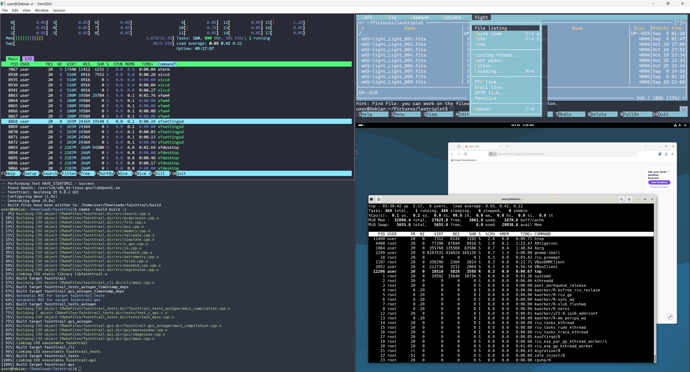
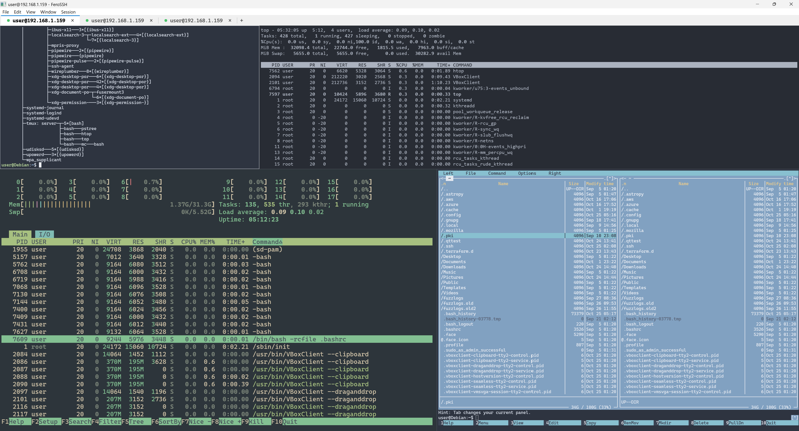

# FeroSSH

*Secure connections. Forged in Rust.*

FeroSSH aims to be the smallest, most secure open-source SSH client for Windows: a native PuTTY replacement with tabs, splits, tmux integration and file transfer, shipped as one signed exe with nothing to install.

> **Status:** milestone 6 (tmux integration). FeroSSH connects with russh from a sandboxed worker process, checks host keys against `~/.ssh/known_hosts`, and signs in with the Windows OpenSSH agent, Pageant, key files, keyboard-interactive or a password. Tabs, splits and a session manager came in milestone 4, file transfer over SFTP in milestone 5.

## Trying the build

Download `ferossh-exe` from the latest CI run and start it with a host, or without one to be asked:

```
ferossh.exe [user@]host[:port]
ferossh.exe -l user -p 2222 host
ferossh.exe myalias            # a Host from ~/.ssh/config
ferossh.exe --local [command]  # a local shell, as in milestone 2
```

`HostName`, `User`, `Port`, `IdentityFile`, `Tag`, `Include` and the forwarding keywords (`LocalForward`, `RemoteForward`, `DynamicForward`, `ForwardX11`, `GatewayPorts`, `ClearAllForwardings`) are read from `~/.ssh/config`.

- **Tabs and splits.** The window starts with one pane and no tab strip. Ctrl+Shift+T opens a tab, Alt+Shift+= and Alt+Shift+- split the pane; the tab strip appears once there are two tabs. A new tab or pane on a host you are already logged in to opens another channel on the same connection, so there is no second login. Drag a divider to resize, drag a tab to reorder, and Ctrl+Shift+drag a pane onto another pane's edge to move it there (or its middle to swap them). To merge a tab back in as a pane, drag the tab down out of the strip onto a pane of the tab that appears (move back up over another tab first to pick that one), or use Window > Join tab into the tab before it (Ctrl+Shift+J); dropping a pane on the tab strip makes it a tab again, and holding it over a tab shows that tab, to drop the pane into it.
- **Serial consoles.** Type a COM port at the connect prompt (`COM3`, `COM3:115200`, `COM3:9600,7E1,xonxoff`) or on the command line, or make a session of type *Serial console* in the session form, with the port, speed, framing (8N1, 8E1, 8O1, 7E1, 7O1, 8N2) and flow control (none, XON/XOFF, RTS/CTS, DSR/DTR). What is left out is 9600 8N1 without flow control, the usual console default of switches and routers. Session > Send break holds the line in break for 300 ms (ROM monitor on Cisco gear, SysRq on Linux). The port is opened by the FeroSSH window itself, not the sandboxed SSH worker, which cannot reach devices. Unplugging a USB adapter ends the session with a note; Enter opens the port again. Logs, themes and broadcast input work as for SSH tabs.
- **Broadcast input.** Window > Broadcast input to this tab's panes (Ctrl+Shift+B) sends what you type and paste in the focused pane to the other panes of the tab as well; Broadcast input to all tabs reaches every pane. Each pane encodes the keys itself, so arrow keys work in vim in one pane and the shell in another. Every pane that receives is framed in amber and the window title says broadcast is on. Window > Leave this pane out of broadcast keeps one pane to itself. Only panes that pass typing straight to their host take part: nothing typed at a password prompt or the connect prompt is broadcast, and a pane waiting at one never receives other panes' keys. A paste with line breaks always asks first while broadcast is on, and says how many panes it goes to.
- **Session manager.** Ctrl+Shift+S shows the hosts from `~/.ssh/config` in a side pane, hidden by default. Type to filter, Enter connects in this tab (Shift+Enter in a split), Ctrl+D marks a favourite. A `# folder: Name` comment above a `Host` groups hosts. View > Side pane on right moves it; drag its edge to resize it.
- **Saved sessions.** No ssh_config needed: "+ New session" at the top of the session manager (or Insert) opens a form in the side pane, and F2 (or a right click) edits the selected session. The form has a name, folder, host or IP address, user, port and key file (with Browse…), then a Look section (theme, font, size, scrollback) and an Extras section (tmux session, port forwards such as `L 8080 localhost:80`, RDP and VNC ports, older crypto). Empty fields show their default in grey; Enter saves, Shift+Enter saves and connects, Esc cancels, Del deletes a saved session after asking. Sessions go to `%APPDATA%\FeroSSH\sessions.conf` in ssh_config syntax and their look to `ferossh.conf`. Hosts from `~/.ssh/config` and the imports show their connection settings read-only (FeroSSH never writes those files); their look and extras can still change, and a new name saves an editable copy.
- **Passwords without typing.** Keys and agents need no password at all; the Windows OpenSSH agent pipe also serves the 1Password and Bitwarden SSH agents, whose keys stay in the vault. For servers that want a password, the session form's Password field picks where it comes from. *Windows Credential Manager* saves the password the first time a login with it works (as `FeroSSH:user@host:port`, protected by your Windows sign-in, on this PC only) and fills it in from then on. *1Password*, *Bitwarden* or *KeePassXC* fill in a command for that tool's CLI (`op`, `bw`, `keepassxc-cli`) that you can edit, or write *a command of your own*; `%n` is the session's name, `%h` the host, `%u` the user, `%p` the port. The command runs without a shell, a window or any input, for at most 60 seconds, and the first line it prints is the password; nothing of it is logged. FeroSSH shows each command and asks before it runs the first time (the yes is kept in `%LOCALAPPDATA%\FeroSSH`, not with the settings, so a copied settings file cannot run anything unasked). If the password from a source is refused, FeroSSH asks you to type it; one-time codes are always typed.
- **Desktop sessions.** A session's type can be an SSH terminal, a Remote desktop (RDP) or a VNC desktop. An RDP session without "Via SSH" opens Windows' Remote Desktop Connection straight to the machine, for Windows PCs and servers. With "Via SSH" set to another session, FeroSSH logs in there first and tunnels the desktop through that connection (Host empty means the SSH host itself). VNC always goes through SSH and opens in the built-in viewer of the desktop build.
- **Imports from other SSH clients.** File > Import sessions lists the clients that have saved sessions on your account: PuTTY and KiTTY (registry), WinSCP (registry or `%APPDATA%\WinSCP.ini`), MobaXterm (`MobaXterm.ini` in `Documents\MobaXterm` or `%APPDATA%\MobaXterm`), mRemoteNG (`%APPDATA%\mRemoteNG\confCons.xml`) and SecureCRT (its `Config\Sessions` folder). Pick one to see its sessions with a box each, untick what you don't want, and choose Import. *From a file…* reads any of these files from a portable install: a `WinSCP.ini`, a `MobaXterm.ini` or `.mxtsessions` export, a `confCons.xml`, or one SecureCRT or KiTTY session file, which brings the folder it is in. Host, user, port, key file, folders and PuTTY/KiTTY port forwards come over, and so do RDP and VNC sessions from MobaXterm and mRemoteNG. They go into `%APPDATA%\FeroSSH\imported-<client>.conf` (PuTTY keeps `putty-sessions.conf`) in ssh_config syntax, in a folder named after the client. Importing again from the same client replaces that file. Names already used by your `~/.ssh/config`, your saved sessions or another import are left out, and so is what has no SSH, RDP or VNC equivalent (telnet, FTP and the like). The preview says what does not come over, such as jump hosts. A VNC session needs *Via SSH* set with F2, since VNC always goes through SSH. An mRemoteNG file encrypted whole with a master password has to be exported unencrypted first. **Passwords are never imported**: the preview flags the sessions that had one, so you can give them a password source instead. PuTTY `.ppk` key files (v2 and v3) work for Ed25519 and ECDSA P-256; RSA `.ppk` keys work through Pageant.
- **File transfer.** Ctrl+Shift+E shows the focused pane's host over SFTP in the side pane, on the same connection (no second login). Enter opens a folder or downloads a file, D downloads (folders whole), U or Ctrl+Shift+U uploads, Del deletes after asking, Tab moves to the transfer queue (Space pauses or resumes, R retries, X cancels, C clears finished ones). Drop files or folders from Explorer on a pane to upload them to the shell's current folder, after a confirmation. Downloads go to your Downloads folder (`DownloadFolder` in `ferossh.conf` changes it). Three files move at once; a dropped connection pauses the queue and it carries on, from where each file stopped, when you log in again. Session > Verify transfers compares SHA-256 on both ends after each file (the server needs `sha256sum`).
- **Safe file names.** An existing file is never overwritten without asking (Overwrite, Skip or Keep both, Shift for all). A folder download does not follow links that lead outside the folder, and server names Windows cannot hold (`CON`, `a:b`, trailing dots, control characters) are made safe or refused. Partial files are `.part` locally and `.filepart` on the server until complete.
- **Following `cd`.** The file view follows the shell's directory when the shell reports it with OSC 7. fish does by default; for bash, add this to `~/.bashrc` on the server: `PROMPT_COMMAND='printf "\e]7;file://%s%s\e\\" "$HOSTNAME" "$PWD"'`. View > File transfer follows cd (or F in the view) turns it off.
- **Port forwarding.** `LocalForward`, `RemoteForward` and `DynamicForward` in `~/.ssh/config` start when you log in; View > Port forwards (Ctrl+Shift+P) lists every connection's forwards with their state and open connections, adds one to the connection you click in the list, or else the focused pane's (type `-L 8080:db.internal:5432`, `-R 9000:localhost:3000` or `-D 1080`, then Enter) and stops the selected one (Del). A dynamic forward is a SOCKS proxy speaking SOCKS 4, 4a and 5. Local listeners take `127.0.0.1` and `::1` unless you give an address (`*:8080`, or `GatewayPorts yes`). Forwards live as long as a tab on that connection does. A tab whose connection forwards shows `⇄`, in amber when the server can reach back into your PC (remote forwards or X11).
- **Remote desktop.** Session > Open remote desktop (Ctrl+Shift+D) shows the Linux desktop of the host you are logged in to, X11 or Wayland, through the SSH connection. The server needs an RDP server: xrdp (`sudo apt install xrdp`) or GNOME Remote Desktop. FeroSSH first checks that something answers on the server's RDP port (3389, or `DesktopPort` in the host's profile in `ferossh.conf`) and says so plainly when nothing does; then it forwards a loopback port to it (33900 to 33999, the same one for the same host each time, never 3389) and opens Windows' Remote Desktop Connection there. Nothing new is opened to the network: the RDP port stays closed on the server's firewall, and the tunnel closes with the connection. The desktop opens in its own window.
- **Remote desktop in a tab (optional build).** `ferossh-desktop.exe`, built with the `desktop-viewer` Cargo feature, adds Session > Open remote desktop in a tab (RDP) and (VNC); `rdp-viewer` and `vnc-viewer` build one of the two. They tunnel the server's RDP port (`DesktopPort`, 3389) or VNC port (`VncPort`, 5900) like the remote desktop above and show the desktop in a FeroSSH tab, keyboard and mouse included. For RDP the server needs xrdp or GNOME Remote Desktop; the tab asks for the user name (the SSH user by default) and password, uses NLA where the server has it, and sends keys as scan codes in your keyboard layout. For VNC it needs a VNC server (x11vnc or TigerVNC for X11, wayvnc or GNOME's VNC mode for Wayland). Everything the server sends, RDP's TLS and login included, is handled in a separate viewer process, in an AppContainer with no capabilities at all (no network, files or registry), and checked again before it is drawn. The viewer only ever connects through the SSH tunnel: VNC's own password is weak, and the RDP server's self-signed certificate is not checked against anything, since the SSH host key already identified the machine. RDP uses [IronRDP](https://github.com/Devolutions/IronRDP) and adds about 2.4 MB to the 3.2 MB exe; VNC is FeroSSH's own code and adds about 80 KB. The standard `ferossh.exe` contains none of this code. The desktop takes the size of its pane, also after a split or a divider drag, where the server can change it (RDP Display Control, which xrdp and Windows have; VNC SetDesktopSize, which TigerVNC's Xvnc has); otherwise the picture is scaled to fill the pane. A desktop tab moves into a split like a terminal tab, and it keeps the SSH connection open after the terminal it came from closed, until the desktop closes too. Not yet: clipboard sharing.

  

  *A VNC desktop in a split pane, between ordinary SSH terminals, all through the same window.*

- **X11 forwarding.** `ForwardX11 yes` for a host sends X programs on the server to an X server on Windows, such as VcXsrv or X410 (FeroSSH ships none); the X server must listen on TCP. The display is `X11Display` in `ferossh.conf`, else `DISPLAY`, else `localhost:0`. The server gets a fake cookie; FeroSSH checks it on each X connection and puts the real one from `%XAUTHORITY%` or `~\.Xauthority` in its place (none, for an X server without access control). X11 is off unless a host turns it on: X programs on the server can see and type into your other X windows.
- **Per-host look.** View > Font and View > Theme change the focused pane; Session > Save font and theme for this host keeps them for the next connection.
- **tmux.** tmux is never started for you unless you ask. Session > Attach tmux types `tmux -CC new-session -A -s main` at the pane's shell (typing `tmux -CC` yourself works too), and tmux's windows and panes become native tabs and panes: no status bar, no prefix key, native scrollback with tmux's history in it, and native copy, paste and search. Splits, new tabs and closing panes go to tmux. Session > Detach tmux, or closing the FeroSSH window, leaves everything running on the server; attach again from any PC and the tabs, splits, fonts and themes come back. A dropped connection reattaches after you log in again. Session > Switch tmux session lists the other sessions (also offered right after attaching). Two layouts, kept per session:
  - *One window per pane* (the default; tmux 3.3 or later): every native pane is its own tmux window, so each pane can have its own font, text size and theme. FeroSSH keeps the splits and looks in the session (`@ferossh-layout`). A plain tmux client shows the panes as separate windows.
  - *tmux's own splits* (untick Session > tmux: one window per pane, or older tmux): each tmux window is a tab and tmux's splits are the panes, one font per window; resizing a pane resizes it in tmux.

  To attach on every login to a host, name the session in its profile. GNU screen has no control mode and runs as an ordinary terminal.

  ```
  Profile web1
      Tmux main
      TmuxLayout ferossh
  ```

  

  *These are tmux windows, you can close FeroSSH and return to pickup the session.*

- **Host keys.** A new host shows its SHA-256 fingerprint and randomart, and you type `yes` to trust it; the key is saved hashed to `known_hosts`. A changed key fills the window with a warning and cannot be bypassed: if you know why it changed, use Session > Replace host key..., which asks twice. Host certificates work as in OpenSSH: with an `@cert-authority` line for the host in `known_hosts`, FeroSSH asks the server for a certificate and accepts it without a prompt when that CA signed it, the hostname is one of its principals and it is in date. `@revoked` CA or host keys are refused.
- **Sign-in.** Keys are tried from the OpenSSH agent first, then Pageant, then key files (`id_ed25519` and `id_ecdsa` unless the config names others). Key files may be Ed25519 or ECDSA P-256, encrypted or not; the passphrase is asked in the terminal and never kept. RSA keys work only through an agent, need 3072 bits or more, and sign with SHA-2. Agents may also hold ECDSA P-384 and P-521 keys (smart cards often do) and user certificates (`ssh-add` adds `id_*-cert.pub` with its key). Then keyboard-interactive (one-time codes) and passwords.
- **Security keys.** FIDO2 keys (`sk-ssh-ed25519@openssh.com`, `sk-ecdsa-sha2-nistp256@openssh.com`) work from key files (`id_ecdsa_sk`, `id_ed25519_sk`, or any `IdentityFile`) through Windows' own WebAuthn dialog, as Windows OpenSSH does: touch a USB or NFC key, or confirm with Windows Hello. Keys held by the OpenSSH agent work too. `ferossh.exe --new-security-key [--hello] [--ed25519] FILE` makes a new key file, like `ssh-keygen -t ecdsa-sk`; `--hello` makes it with Windows Hello, so no hardware key is needed.
- **Sandbox.** The worker that talks to the network runs in an AppContainer with network access only: it cannot read your files or keys, and asks the window for every signature. Windows does not let AppContainers reach 127.0.0.1, so use `--no-sandbox` for SSH servers on the same machine. Forwards to and from localhost work in the sandbox: the window holds those sockets, and the worker parses what arrives (SOCKS requests, X11 setups).
- **Logs.** Session > Log to file writes what the host sends to `%LOCALAPPDATA%\FeroSSH\logs`, one file per tab named by host, tab and time (`host_tab1_2026-10-24_2215.log`). Plain logs keep the readable text; Session > Log raw output keeps every byte. Passwords and passphrases never reach the log. Every log is sealed as it is written: `host_tab1_….log.chain` beside it holds a SHA-256 hash chain over the log's bytes (a seal at least every 10 seconds while output comes), and when the log ends its last seal goes into `log-index.chain`, where each line also hashes the one before. Session > Check a log for changes says whether a log is intact, or where it was changed, cut short or added to. This makes edits visible, not impossible: someone using your Windows account could rewrite a log, its chain and the index together, so copy `log-index.chain` somewhere else when a log has to hold up later.

| Shortcut | Action |
| --- | --- |
| Ctrl+Shift+N / Ctrl+Shift+R | Connect to another host in a new tab, reconnect |
| Ctrl+Shift+T / Ctrl+Shift+W | New tab, close the pane |
| Alt+Shift+= / Alt+Shift+- | Split right, split down |
| Alt+arrows / Alt+Shift+arrows | Focus the pane in that direction, grow the pane |
| Ctrl+Tab / Ctrl+Shift+Tab | Next tab, previous tab (Ctrl+Shift+PgUp/PgDn moves it) |
| Ctrl+Shift+J | Join this tab into the tab before it, as a pane |
| Ctrl+Shift+S | Session manager |
| Ctrl+Shift+E / Ctrl+Shift+U | File transfer, upload files |
| Ctrl+Shift+P | Port forwards |
| Ctrl+Shift+D | Open remote desktop |
| Ctrl+Shift+C / Ctrl+Shift+V | Copy the selection, paste (also Ctrl+Insert / Shift+Insert) |
| Ctrl+Shift+F | Find in scrollback (Enter: older match, Shift+Enter: newer, Esc: close) |
| Shift+PgUp / Shift+PgDn | Scroll back a page, forward a page (Ctrl+Shift+Home/End: top, bottom) |
| Mouse drag, double-click, triple-click | Select characters, words, lines; Alt+drag selects a block |
| Shift+drag | Select even when the program has mouse reporting on |
| Ctrl+click | Open a link (OSC 8) after showing its real target |
| Ctrl+= / Ctrl+- / Ctrl+0, Ctrl+wheel | Larger, smaller, default text size |
| Ctrl+Shift+M | Hide the menu bar (Alt shows it again) |
| View > Font, View > Theme | Font family and colour theme for this pane |
| View > Show test pattern | Colours, styles, box drawing, wide and combining characters |

Edit > Copy on select and Edit > Right-click pastes turn on the PuTTY habits; both are off by default.

### Colour themes

Built in: Nord (the default), Dracula, Catppuccin Mocha, Gruvbox Dark, Solarized Dark, Tokyo Night, One Dark, Monokai, Rosé Pine, Everforest, Campbell and One Half Light, plus two warning themes: **Production** (muted red background, red cursor) and **Staging** (amber). `ferossh.exe --theme Production prod-db` opens a session in a given theme, which is handy for desktop shortcuts.

The theme follows the host automatically: a host tagged `production`, `staging` or `development` with ssh_config's `Tag` keyword gets Production, Staging or Nord, and your own rules can match host patterns (`*.prod.example.com !prod-sandbox`) or tags, with an optional red or amber tint over any theme. Rules and per-host profiles live in `%APPDATA%\FeroSSH\ferossh.conf`:

```
ThemeRule
    Hosts *.prod.example.com !prod-sandbox
    Theme Production
ThemeRule
    Tags staging
    Theme Nord
    Tint ffb000 40
Profile web1
    Font Cascadia Mono
    FontSize 12
    Theme Dracula
```

`Tint` mixes a colour (hex) into the theme by 0 to 255. A host's profile wins over the rules, and the rules over `--theme`. The palettes are the themes' published terminal colours; all are MIT licensed except Tokyo Night's terminal port (Apache-2.0).

## Design

- Native Win32 with DirectWrite/Direct2D rendering. No Electron, Qt or Java.
- Two processes: a UI process that never parses network data, and an AppContainer-sandboxed SSH worker that never sees private keys or your files.
- Modern crypto only. Post-quantum `mlkem768x25519-sha256` key exchange first; no SHA-1, CBC, DSA or `ssh-rsa` signatures (see [`crypto_policy.rs`](crates/worker/src/crypto_policy.rs)).
- Older switches, routers and SSH servers that lack those can be allowed per host with `LegacyAlgorithms yes` in the host's `Profile` in `ferossh.conf`. This adds ECDH on NIST curves, DH groups 14 to 18 with SHA-2, AES-CTR and plain HMAC-SHA-2, still with no SHA-1, CBC or DSA. A tab that uses them shows an amber `⚠`, and when a connection fails for lack of them FeroSSH says so. A server without strict key exchange (Terrapin) gets AES-GCM instead of ChaCha20-Poly1305.
- Keys stay in the Windows OpenSSH agent, Pageant, a FIDO2 token or the TPM. Passwords are never stored.
- OpenSSH `ssh_config` is the session format.

## Workspace

| Crate | Role |
| --- | --- |
| [`app`](crates/app) | Win32 entry point, window, tabs and splits, message loop |
| [`render`](crates/render) | DirectWrite/Direct2D glyph atlas and grid drawing |
| [`term`](crates/term) | VT emulation wrapper, sanitising, paste and clipboard policy |
| [`worker`](crates/worker) | Sandboxed SSH worker: russh sessions, channels, forwards |
| [`ipc`](crates/ipc) | UI/worker message types, framing and fuzz targets |
| [`auth`](crates/auth) | Agent, Pageant, WebAuthn and CNG signing broker |
| [`sftp`](crates/sftp) | SFTP codec, transfer queue and file-tree model |
| [`forward`](crates/forward) | SOCKS 4/4a/5 handshake, X11 display, `.Xauthority` and cookie swap |
| [`tmuxcc`](crates/tmuxcc) | tmux control-mode parser and layout mapping |
| [`config`](crates/config) | `ssh_config` parser, known_hosts and imports from other SSH clients |
| [`viewer`](crates/viewer) | VNC and RDP clients, viewer process and its pipe protocol (only with the `vnc-viewer` or `rdp-viewer` feature) |

## Building

Requirements: Rust via rustup (the pinned toolchain in `rust-toolchain.toml` installs itself), Visual Studio Build Tools with the MSVC toolchain, and the Windows SDK. No CMake, NASM or extra C toolchain.

```
cargo build --release -p ferossh
```

The release profile optimises for size and links the C runtime statically, so `target\release\ferossh.exe` runs on a clean Windows 10 1903+ machine.

With the built-in desktop viewer: `cargo build --release -p ferossh --features desktop-viewer` (RDP and VNC), or `--features rdp-viewer` or `--features vnc-viewer` for one. CI builds the standard exe, the VNC-only one and the full one, uploads them as `ferossh.exe`, `ferossh-vnc.exe` and `ferossh-desktop.exe`, and reports their sizes.

Checks run in CI: `cargo fmt`, `cargo clippy`, `cargo test`, `cargo deny`, `cargo audit`, SSH tests against a real OpenSSH server on Linux (`cargo test -p ferossh-worker --test sshd`, skipped where `sshd` is not installed), the tmux integration against a real tmux (`cargo test -p ferossh tmux_e2e`, skipped without tmux), the RDP viewer against a real xrdp (`FEROSSH_TEST_RDP="127.0.0.1:3389 user password" cargo test -p ferossh-viewer --features rdp rdp::`), the VNC viewer's resize against a real Xvnc (`FEROSSH_TEST_VNC=127.0.0.1:5905 cargo test -p ferossh-viewer --features vnc resizes_a_real_server`), and fuzz smoke runs of the IPC decoder, the SFTP decoder, the tmux control-mode client, the SOCKS and X11 parsers, the VNC client, the RDP session's decoders and the terminal (`cargo +nightly fuzz run --target x86_64-unknown-linux-gnu term_feed`).

Releases: pushing a version tag (`git tag v0.1.0 && git push origin v0.1.0`) runs [`release.yml`](.github/workflows/release.yml). It checks that the tag matches the version in `Cargo.toml` and that `docs/releases/<tag>.md` exists, runs every CI job, and publishes a GitHub Release with `ferossh.exe`, `ferossh-desktop.exe`, `SHA256SUMS.txt`, a release manifest (`BUILD-MANIFEST.json`: tag, commit, toolchain, and each exe's size and SHA-256 before and after signing) and those notes. The exes, sums and manifest get build provenance attestations signed with the workflow's identity, so `gh attestation verify ferossh.exe -R jkobierczynski/FeroSSH` checks a download. Builds are reproducible: `pwsh scripts/build-release.ps1` on a release's tag gives the same bytes as the manifest's unsigned hashes, and CI checks that on every change. Run the workflow by hand from the Actions tab for a dry run: everything but the attestation and the release, with the files uploaded as the `release-dry-run` artifact. The exes are signed when the `WINDOWS_SIGNING_CERT` (a base64 `.pfx`) and `WINDOWS_SIGNING_CERT_PASSWORD` secrets are set, and go out unsigned otherwise.

On Linux or macOS, `cargo run -p ferossh-term --example vttest -- 1 2 8` drives [vttest](https://invisible-island.net/vttest/) through the emulator and prints every screen as text.

## Licence

Licensed under either of [Apache License, Version 2.0](LICENSE-APACHE) or [MIT license](LICENSE-MIT) at your option.

Unless you explicitly state otherwise, any contribution intentionally submitted for inclusion in FeroSSH by you, as defined in the Apache-2.0 license, shall be dual licensed as above, without any additional terms or conditions.
