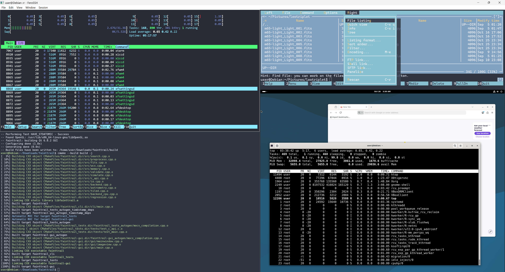
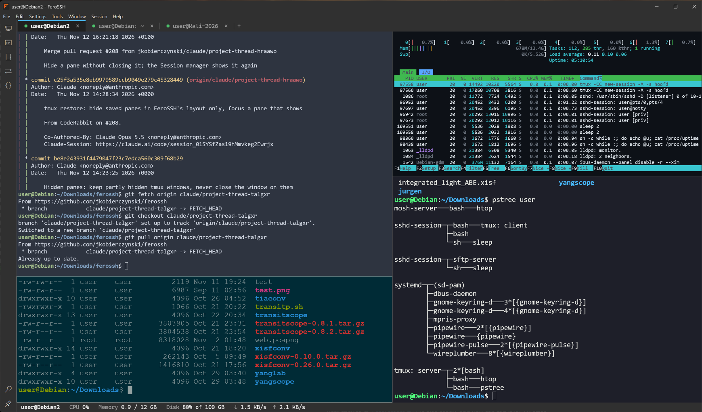

<p align="center"></p>

# FeroSSH

*Secure connections. Forged in Rust.*

FeroSSH is the native, open-source SSH client for Windows that locks every connection in its own AppContainer sandbox, away from your keys and files: sensibly minimalistic and native, with tabs, splits, tmux integration, port forwarding, scripts and file transfer, in one signed exe with nothing to install.

> **Status:** [1.0 is out](https://github.com/jkobierczynski/FeroSSH/releases/tag/v1.0.0), the first stable release. FeroSSH connects with russh from one sandboxed worker process per connection, checks host keys against `~/.ssh/known_hosts`, and signs in with the Windows OpenSSH agent, Pageant, key files, FIDO2 security keys, keyboard-interactive or a password. It has tabs and splits, saved connections with imports from PuTTY, KiTTY, WinSCP, MobaXterm, mRemoteNG and SecureCRT, password sources, jump hosts (`ProxyJump`, `ProxyCommand`), SOCKS 5 and HTTP proxies, SFTP and ZMODEM file transfer, port and X11 forwarding, tmux integration, serial consoles, Mosh, Telnet for old gear, broadcast input, login scripts and other scripts, remote desktops through SSH, and sealed session logs.

The [user guide](docs/guide/README.md) covers getting started, every feature, every menu item and shortcut ([menu reference](docs/guide/menus.md)), logs and their seals, every setting, the security model, verifying a download and troubleshooting.

## Download

Download `ferossh.exe` from the [latest release](https://github.com/jkobierczynski/FeroSSH/releases/latest) (or `ferossh-exe` from the latest CI run for the newest changes) and start it with a host, or without one to be asked. Release exes are code signed. The certificate is new, so Windows SmartScreen may still warn the first time you run one until it has built up a reputation; [Verifying a download](docs/guide/verifying-downloads.md) shows how to check the signature, `SHA256SUMS.txt` and the build provenance attestation (see [Code signing](#code-signing)).

```
ferossh.exe [user@]host[:port]
ferossh.exe -l user -p 2222 host
ferossh.exe myalias            # a Host from ~/.ssh/config
ferossh.exe COM3:115200       # a serial console
ferossh.exe telnet://router   # Telnet (unencrypted), port 23 unless given
ferossh.exe winrm://LAB\admin@win-srv  # PowerShell on a Windows server over WinRM
ferossh.exe --local [command]  # a local shell
ferossh.exe --check-sandbox    # report what the sandbox can do on this PC
```

`HostName`, `User`, `Port`, `IdentityFile`, `CertificateFile`, `IdentitiesOnly`, `IdentityAgent`, `Tag`, `Include`, `Match`, `ProxyJump`, `ProxyCommand`, `ForwardAgent`, `GSSAPIAuthentication`, `GSSAPIDelegateCredentials`, `GSSAPIServerIdentity`, `SendEnv`, `SetEnv`, `RemoteCommand`, `RequestTTY`, `StrictHostKeyChecking`, `UserKnownHostsFile`, `HostKeyAlias`, `AddressFamily` and the forwarding keywords (`LocalForward`, `RemoteForward`, `DynamicForward`, `ForwardX11`, `GatewayPorts`, `ClearAllForwardings`) are read from `~/.ssh/config`.

- **Tabs and splits.** The window starts with one pane and no tab strip. Ctrl+Shift+T opens a tab, Alt+Shift+= and Alt+Shift+- split the pane; the tab strip appears once there are two tabs. New tabs and panes start in the directory the pane they came from is in: in tmux FeroSSH asks tmux for it, over plain SSH it uses the directory the shell reported or showed in its prompt (as the file view's follow cd does) and types a `cd` there after login, and a local shell starts in the folder its cmd or PowerShell prompt shows. A new tab or pane on a host you are already logged in to opens another channel on the same connection, so there is no second login. Drag a divider to resize, drag a tab to reorder, and Ctrl+Shift+drag a pane onto another pane's edge to move it there (or its middle to swap them). To merge a tab back in as a pane, drag the tab down out of the strip onto a pane of the tab that appears (move back up over another tab first to pick that one), or use Window > Join tab into the tab before it (Ctrl+Shift+J); dropping a pane on the tab strip makes it a tab again, and holding it over a tab shows that tab, to drop the pane into it.
- **Serial consoles.** Type a COM port at the connect prompt (`COM3`, `COM3:115200`, `COM3:9600,7E1,xonxoff`) or on the command line, or make a connection of type *Serial console* in the connection form, with the port, speed, framing (8N1, 8E1, 8O1, 7E1, 7O1, 8N2) and flow control (none, XON/XOFF, RTS/CTS, DSR/DTR). What is left out is 9600 8N1 without flow control, the usual console default of switches and routers. Session > Send break holds the line in break for 300 ms (ROM monitor on Cisco gear, SysRq on Linux). The port is opened by the FeroSSH window itself, not the sandboxed SSH worker, which cannot reach devices. Unplugging a USB adapter ends the session with a note; Enter opens the port again. Logs, themes and broadcast input work as for SSH tabs.
- **Telnet**, for old switches, routers and console servers that have nothing better. Type `telnet://host[:port]` or `telnet host port` at the connect prompt, or make a connection of type *Telnet (unencrypted)* in the connection form (port 23 unless you give one). Telnet sends everything in the clear, passwords included, so the pane says so when it connects and the tab carries a red **⚠ telnet** badge. The connection runs in a sandboxed worker of its own, like an SSH connection, and the Telnet option parser there is fuzz-tested. FeroSSH agrees only to binary mode, echo, suppress-go-ahead, terminal type (`xterm-256color`) and window size (sent again on every resize), and refuses every other option; it never sends environment variables or a user name. SFTP, forwards, tmux and remote desktops are SSH-only. Logs, themes and broadcast input work as for SSH tabs.
- **WinRM**, for PowerShell or cmd on Windows servers through their WinRM service (HTTP on port 5985 or HTTPS on 5986), as `Enter-PSSession` and `winrs` reach them. Type `winrm://[user@]host` at the connect prompt or make a connection of type *WinRM (PowerShell, cmd)*. The login is Kerberos or NTLM through Windows itself, with your Windows logon or a user and password you type, and the shell's requests and replies are encrypted with its keys (the login tokens themselves travel in the HTTP `Authorization` header, as WinRM over HTTP sends them). Over HTTPS (`winrms://host`) Windows' own TLS runs in the window, and a certificate Windows does not trust is shown by fingerprint and asked about once, then pinned like an SSH host key. The password and the keys stay in the window; the sandboxed worker parses what the server sends and only relays tokens and encrypted messages. WinRM's remote shell has no terminal, so lines are edited locally and sent on Enter (Up and Down recall earlier ones, Ctrl+C interrupts); full-screen programs need SSH.
- **Broadcast input.** Window > Broadcast input to this tab's panes (Ctrl+Shift+B) sends what you type and paste in the focused pane to the other panes of the tab as well; Broadcast input to all tabs reaches every pane. Each pane encodes the keys itself, so arrow keys work in vim in one pane and the shell in another. Every pane that receives is framed in amber and the window title says broadcast is on. Window > Leave this pane out of broadcast keeps one pane to itself. Only panes that pass typing straight to their host take part: nothing typed at a password prompt or the connect prompt is broadcast, and a pane waiting at one never receives other panes' keys. A paste with line breaks always asks first while broadcast is on, and says how many panes it goes to.
- **Login scripts.** A connection's Extras section in the connection form holds a login script, one step per line, for devices that need answers after the login: `expect Username:` waits up to 15 seconds for that text, `send terminal length 0` types a line and Enter (`send` alone is just Enter), `password` types the connection's login password from its password source, `secret enable` types a named secret, and `pause 2` waits. It runs once after an SSH login or when a serial port opens; tmux attaches after it. Secrets are never written to a FeroSSH file: the first time, the pane asks for one (without echo) and keeps it in the Windows Credential Manager as `FeroSSH secret:<name>`, or a `Secret` block in `ferossh.conf` names a password manager command for it (`%n` is the secret's name). Pressing any key stops the script, and Session > Run login script again starts it over. What the script types is never broadcast.
- **Command palette.** Ctrl+Shift+A (Tools > Command palette) is one search box over every menu action, every saved connection and every command script. Type a few letters in any order (`splr` finds Split right, `core` your core switch, `ctrl+shift+n` the action on that key), then Enter runs the action, connects to the connection or types the script; Shift+Enter connects in a split or types a script without its last Enter. Each action shows its shortcut and check mark, greyed-out menu items are left out, and the last few picks come first. Esc closes it.
- **Scripts.** Ctrl+Shift+Space (Tools > Scripts) lists named command lines. Type to filter, then Enter types the script with Enter after each line, or Shift+Enter leaves the last line for you to finish; with broadcast input on it goes to every broadcast pane too. Scripts are grouped under categories (Left and Right jump between them), and the search looks at names, categories and lines. Insert adds a script (what you typed as a filter becomes its name), F2 edits one, Delete removes one; Edit > Save selection as script starts one from text selected in a pane, and Ctrl+Shift+V pastes into the editor (several lines become several script lines). A script can take arguments: `$1` to `$9`, or `${1:Gi0/1}` with a default. Running it first asks for the values in the side pane, prefilled with the defaults, and shows what will be typed; Enter moves to the next value and types on the last. `$$` types a plain `$`, so `awk '{print $$1}'` stays `awk '{print $1}'`; other `$` text such as `$HOME` is left alone. Each script is a file of its own in `%APPDATA%\FeroSSH\scripts`, a folder per category, so scripts can be copied to another PC, kept in git or shared (Tools > Open scripts folder). File > Import scripts brings them over from Windows Terminal, SecureCRT button bars, MobaXterm macros or a text file.
- **Script steps and logic.** A script line can be a step: `@expect (config)#` waits for the host, `@capture Version *,` keeps a value from the reply, `@pause 2`, `@delay 300ms`, `@key enter` (or `tab`, `escape`, arrows, `f1` to `f12`, `ctrl+z`, `alt+x`, `alt+right`, `shift+tab`, several at once with counts: `@key down 3 enter`), `@type y` (no Enter; Shift+Enter in the editor makes a line one), `@pane right` and `@tab next` (the rest of the script goes to that pane), `@password` and `@secret enable`; `@@` types a plain `@`. Expect-style logic needs no extra program: `@on` waits for whichever of several texts comes first and jumps to its `@label`, with `@goto`, `@if ${tries} > 3 goto give_up`, `@timeout 60 goto slow`, `@set`, `@add`, `@show`, `@stop` and `@fail`; values from `@capture` land in `${captured}` but can never become a key or a step. Login scripts take the same steps. Variables fill themselves in: `${session}`, `${host}`, `${user}`, `${port}`, `${date}`, `${time}`, `${stamp}` (for file names) and `${clipboard}`, so `copy run tftp://10.0.0.5/${host}-${stamp}.cfg` needs no typing (`${HOME}` and other names are left alone). In the editor a script can be kept to some hosts (`sw-* core-?`) or connection-manager folders; those for the focused pane's host are listed first, the others dimmed, and the command palette shows only the ones that apply. A script can have a hotkey, Ctrl+Shift+F1 to F12. Run on several panes (broadcast), or with `@capture` steps, it shows a live report in the side pane: one row per host with its state and captured values. In the report Enter shows that host's pane, C copies the report as a table for a spreadsheet and S saves it as CSV in the download folder.
- **Runs on many hosts.** F5 on a script picks saved SSH connections to run it on, without opening them first: Space picks a host, or a whole connection-manager folder on its heading, and the hosts the script is kept to come picked. Each host logs in in a session of its own that no tab shows, with its own sandboxed worker (or a new channel on a connection you already have open), 4 at once by default (*At once*, 1 to 16). The live report shows each host queued, logging in, running, done or failed, with the values its `@capture` steps kept, and Enter on a row brings that host's session into a tab, live, while it runs or after. A run never accepts a host key and never asks: a host with an unknown key, a login that wants a password (unless you typed one for the run, kept in memory only) or a code fails with what it asked, and you can show it and answer by hand. Each host gets 2 minutes. Escape stops the run, R runs the failed hosts again, and closing the report ends the sessions it opened. Production hosts in a run are confirmed once, all listed.
- **Auto-responses.** A script's *When* text makes it answer by itself whenever the host prints that text, for example `@key space` when `--More--` appears, or `@key enter` on `[confirm]`, on the hosts it is kept to. The host only decides *when*: an auto-response types only lines and keys you wrote, never a password, a secret, the clipboard or arguments, and after 20 answers in one second it pauses until you type. Session > Auto-responses from scripts turns them all off.
- **Production guard.** A script about to be typed into a pane with the red Production theme (by a theme rule, the `production` tag or by hand) asks first, listing the hosts and the lines. Session > Confirm scripts on Production hosts turns it off.
- **Recording.** Edit > Record keystrokes as script records what you type in the focused pane until you pick it again, then opens it in the script editor to name and check. Backspace, Ctrl+U and Ctrl+W edit lines as a shell does, Tab and Ctrl+ keys are kept as `@key` steps so tab completion replays, and a line the host did not echo back (a password) is recorded as `@password`, never as its text.
- **Connection manager.** Ctrl+Shift+S shows the hosts from `~/.ssh/config` in a side pane, hidden by default. Type to filter, Enter connects in this tab (Shift+Enter in a split), Ctrl+D marks a favourite. A `# folder: Name` comment above a `Host` groups hosts. Settings > Side pane on right moves it; drag its edge to resize it.
- **Mosh**, for laptops and bad networks. Make a connection of type *Mosh terminal (SSH + UDP)*: FeroSSH logs in over SSH as usual (keys, agent, passwords, jump hosts), starts `mosh-server` on the host and then talks to it over UDP, as the `mosh` command does. The session survives Wi-Fi changes, a new IP address and sleep; when the server goes quiet a bar on the top line says how long ago it was last heard. The host needs Mosh installed (`apt install mosh`) and its UDP ports (60001 to 60999, or the range set in the form) open. FeroSSH speaks the Mosh protocol itself, AES-128-OCB and all, in the sandboxed worker, and the parsers for the server's packets and screens are fuzz-tested. SFTP and forwards still use the SSH login; tmux integration needs SSH, so run tmux in the pane as usual. On a slow link, typing shows at once (underlined until the server confirms it when the round trip is 80 ms or more), and text a program hides, such as a password, never does.
- **Session manager.** Ctrl+Shift+L (Tools > Session manager) lists every session open right now, in all tabs: its host, kind (SSH, Mosh, WinRM, Telnet, serial, tmux, desktop or local shell), tab and state, with notes such as tmux, forwards, logging or a jump host, and the sessions of a script run that no tab shows. The list updates as sessions connect, drop and reconnect. Type to filter, Enter or a double-click goes to the session's tab and pane, F2 renames it, and Del closes it after asking. Saved hosts stay in the connection manager.
- **Rename sessions.** Window > Rename session, a double-click on a tab, or a tab's right-click menu gives a session a name of its own. The tab and window title show it instead of the title the host sets, until you clear it (empty the name and press Enter). In a tmux session the name also goes to the tmux window and is saved with the layout, so it comes back when you attach again, from any PC.
- **Saved connections.** No ssh_config needed: "+ New connection" at the top of the connection manager (or Insert) opens a form in the side pane, and F2 (or a right click) edits the selected connection. The form has a name, folder, host or IP address, user, port, key file (with Browse…), password source, jump host and proxy, then a Look section (theme, font, size, scrollback) and an Extras section (tmux session, port forwards such as `L 8080 localhost:80`, RDP and VNC ports, older crypto). Empty fields show their default in grey; Enter saves, Shift+Enter saves and connects, Esc cancels, Del deletes a saved connection after asking. Connections go to `%APPDATA%\FeroSSH\sessions.conf` in ssh_config syntax and their look to `ferossh.conf`. Hosts from `~/.ssh/config` and the imports show their connection settings read-only (FeroSSH never writes those files); their look and extras can still change, and a new name saves an editable copy.
- **Passwords without typing.** Keys and agents need no password at all; the Windows OpenSSH agent pipe also serves the 1Password and Bitwarden SSH agents, whose keys stay in the vault. For servers that want a password, the connection form's Password field picks where it comes from. *Windows Credential Manager* saves the password the first time a login with it works (as `FeroSSH:user@host:port`, protected by your Windows sign-in, on this PC only) and fills it in from then on. *1Password*, *Bitwarden* or *KeePassXC* fill in a command for that tool's CLI (`op`, `bw`, `keepassxc-cli`) that you can edit, or write *a command of your own*; `%n` is the connection's name, `%h` the host, `%u` the user, `%p` the port. The command runs without a shell, a window or any input, for at most 60 seconds, and the first line it prints is the password; nothing of it is logged. FeroSSH shows each command and asks before it runs the first time (the yes is kept in `%LOCALAPPDATA%\FeroSSH`, not with the settings, so a copied settings file cannot run anything unasked). If the password from a source is refused, FeroSSH asks you to type it; one-time codes are always typed.
- **Desktop sessions.** A saved connection's type can be an SSH terminal, a Remote desktop (RDP) or a VNC desktop. An RDP connection without "Via SSH" opens Windows' Remote Desktop Connection straight to the machine, for Windows PCs and servers. With "Via SSH" set to another saved connection, FeroSSH logs in there first and tunnels the desktop through that connection (Host empty means the SSH host itself). VNC always goes through SSH and opens in the built-in viewer of the desktop build.
- **Imports from other SSH clients.** File > Import connections lists the clients that have saved sessions on your account: PuTTY and KiTTY (registry), WinSCP (registry or `%APPDATA%\WinSCP.ini`), MobaXterm (`MobaXterm.ini` in `Documents\MobaXterm` or `%APPDATA%\MobaXterm`), mRemoteNG (`%APPDATA%\mRemoteNG\confCons.xml`) and SecureCRT (its `Config\Sessions` folder). Pick one to see its sessions with a box each, untick what you don't want, and choose Import. *From a file…* reads any of these files from a portable install: a `WinSCP.ini`, a `MobaXterm.ini` or `.mxtsessions` export, a `confCons.xml`, or one SecureCRT or KiTTY session file, which brings the folder it is in. Host, user, port, key file, folders and PuTTY/KiTTY port forwards come over, and so do Telnet sessions (from all but WinSCP) and RDP and VNC sessions from MobaXterm and mRemoteNG. They go into `%APPDATA%\FeroSSH\imported-<client>.conf` (PuTTY keeps `putty-sessions.conf`) in ssh_config syntax, in a folder named after the client. Importing again from the same client replaces that file. Names already used by your `~/.ssh/config`, your saved sessions or another import are left out, and so is what has no SSH, Telnet, RDP or VNC equivalent (raw, rlogin, FTP and the like). Jump hosts (WinSCP tunnels, MobaXterm SSH gateways) come over as the session's jump host, and SOCKS 5 and HTTP proxies from PuTTY, KiTTY and WinSCP as its proxy (without the proxy's password). The preview says what does not come over, such as a jump host's own key file or SecureCRT firewalls. A VNC session needs *Via SSH* set with F2, since VNC always goes through SSH. An mRemoteNG file encrypted whole with a master password has to be exported unencrypted first. **Passwords are never imported**: the preview flags the sessions that had one, so you can give them a password source instead. PuTTY `.ppk` key files (v2 and v3) work for Ed25519 and ECDSA P-256; RSA `.ppk` keys work through Pageant.
- **File transfer.** Ctrl+Shift+E opens a Local and a Remote file list in the tools pane, side by side or stacked, for the focused pane's host over SFTP on the same connection (no second login). Arrow buttons between them, Ctrl+Enter or a drag from one list to the other upload or download the selection (folders whole); drop files from Explorer on the Remote list or on a pane to upload them, after a confirmation. Named bookmarks open a Local and a Remote folder together (for any host or one), Sync browsing opens the same folder in both lists, and a connection can name the Local and Remote folders File transfer starts in. A filter narrows both lists by name (`*.log` patterns too), Del deletes on the server after asking, the right-click menu makes folders, renames (F2) and sets permissions (`755` or `u+x`), *Edit locally* opens a server file in your editor and puts it back on every save, and downloads go to the Local list's folder, which FeroSSH remembers (`DownloadFolder` in `ferossh.conf`; your Downloads folder until you pick one). The queue under the lists shows progress, with pause, resume, retry and cancel on its right-click menu. Three files move at once; a dropped connection pauses the queue and it carries on, from where each file stopped, when you log in again. Session > Verify transfers compares SHA-256 on both ends after each file (the server needs `sha256sum` and `xargs`). For SFTP-only accounts (`ForceCommand internal-sftp`, upload users, hosting), a connection of type *SFTP file transfer only*, or `sftp://user@host[:port][/folder]` at the connect prompt, logs in without asking for a shell and opens File transfer straight away; WinSCP's SFTP sites and MobaXterm's SFTP sessions import as such.

- **Keyword highlighting.** Errors and failures show in red, warnings in yellow, success in green and IP and MAC addresses in cyan and magenta, like MobaXterm's syntax highlighting, with your own word lists and regular expressions on top (`HighlightRule` in `ferossh.conf`, per host if you like). Only plain text is recoloured, so programs keep their own colours, and full-screen programs are left alone. Session > Highlight keywords, or `Highlight no` for one host, turns it off.
- **Stop following at a match.** Scrolling back stops following the output and getting back to the bottom (Shift+PgDn, End, Ctrl+Shift+End or typing) follows again. Edit > Stop following at a match... also stops it when new output matches a regular expression, holding the view on that line while the output carries on below, which is handy with `tail -f` or a long build. Patterns run on a linear-time engine with size limits, so none can hang the window.
- **ZMODEM (`rz`/`sz`)**, for hosts and console servers without SFTP, over SSH or Telnet. Turn it on with Session > ZMODEM: answer rz and sz (`ZModem yes` in `ferossh.conf`); it is off by default, so their output shows as it is. Then `sz file` on the server saves the file in your download folder (as `name (2)` if one is there already, never overwriting), and `rz` opens a file picker for what to send. Progress shows in the pane, and Ctrl+C cancels. The protocol runs in the sandboxed worker and is fuzz-tested; the window only reads the files you picked and writes into the download folder, and a request to run a command (ZCOMMAND) stops the transfer. Files over 4 GB need SFTP (ZMODEM's limit).
- **Safe file names.** An existing file is never overwritten without asking (Overwrite, Skip or Keep both, Shift for all). A folder download does not follow links that lead outside the folder, and server names Windows cannot hold (`CON`, `a:b`, trailing dots, control characters) are made safe or refused. Partial files are `.part` locally and `.filepart` on the server until complete.
- **Following `cd`.** The file view, and files dropped on a terminal, follow the shell's directory. Shells that report it with OSC 7 (fish does by default) work anywhere; otherwise FeroSSH reads it from a `user@host:dir$ ` prompt, bash's default on Debian and Ubuntu. For other prompts, add this to `~/.bashrc` on the server: `PROMPT_COMMAND='printf "\e]7;file://%s%s\e\\" "$HOSTNAME" "$PWD"'`. Settings > File transfer follows cd (or Follow terminal in the view) turns it off.
- **Port forwarding.** `LocalForward`, `RemoteForward` and `DynamicForward` in `~/.ssh/config` start when you log in; Tools > Port forwards (Ctrl+Shift+P) is a native pane: a form to add a forward (type, listen port, target, and the connection it goes on; `-L 8080:db.internal:5432` typed whole works too) above a list of every connection's forwards with their state, and Edit, Retry and Stop (Del) for the selected one. All of this works on a live connection, without reconnecting. Edit (Enter or F2) puts a forward in the form to change its port or target; a new target on the same port keeps the open connections. `-KL 8080`, `-KR 9000` and `-KD 1080` stop a forward by its port, as `~C` does in OpenSSH. Changes made this way last for the tab's reconnects; the saved session is left as it was. A dynamic forward is a SOCKS proxy speaking SOCKS 4, 4a and 5. Local listeners take `127.0.0.1` and `::1` unless you give an address (`*:8080`, or `GatewayPorts yes`). Forwards live as long as a tab on that connection does. A tab whose connection forwards shows `⇄`, in amber when the server can reach back into your PC (remote forwards or X11).
- **Agent forwarding.** `ForwardAgent yes` (or *Fwd agent* in a saved connection) lets `ssh` and `git` on the server use your agent's keys. FeroSSH asks before every signature and names the host a login is for; Cancel refuses everything else from that connection. The sandboxed worker passes on only key lists and signatures, and anything but a login or SSH signature is refused.
- **Kerberos login.** On a PC in a Windows domain, FeroSSH logs in to servers that take Kerberos (`gssapi-with-mic`) with your Windows logon's tickets, so no password or key is needed, as PuTTY does. The server must prove it holds its own service key before anything is signed. `GSSAPIAuthentication yes` or `no` (or *Kerberos* in a saved connection) turns it on or off per host; `GSSAPIDelegateCredentials yes` (*Fwd ticket*) passes a ticket on for logins onward from the server. The tickets stay in the window; the sandboxed worker only passes on the exchange.
- **Jump hosts.** `ProxyJump bastion` (or `admin@gw:2222,inner` for several in turn, as `ssh -J` takes them) in `~/.ssh/config`, or the *Jump host* field of the connection form, reaches a host through others. Each jump host is a login of its own, in a sandboxed worker of its own: its host key is checked against `known_hosts` and it signs in with its own keys or password, as if you had connected to it. Its worker only opens a TCP stream to the next hop, and the next hop's worker runs its SSH connection over that stream, encrypted end to end, so a jump host (or its worker) never sees the target's keys or what you type there. The pane says where each hop is, and which jump host could not reach the next one and why. `ProxyCommand` (such as `corkscrew proxy 8080 %h %p`) runs a local program instead and sends the connection through its input and output; FeroSSH asks once before it runs a command line it has not run before, and shows what the program printed when it fails. `ProxyJump none` or `ProxyCommand none` turns either off for a host.
- **SOCKS 5 and HTTP proxies.** When the way out of a network is a proxy, give the connection one in the *Proxy* field of the form, `socks5://proxy.corp:1080` or `http://me@proxy.corp:3128`, or `ProxyServer` with the same URL in `~/.ssh/config` (FeroSSH's own keyword, so add `IgnoreUnknown ProxyServer` above it if OpenSSH reads that file too). The usual proxy commands, `nc -X 5 -x proxy:1080 %h %p`, `nc -X connect -x proxy:3128 %h %p`, `ncat --proxy proxy:8080 --proxy-type socks5 %h %p` and `connect -S proxy:1080 %h %p`, are done the same way without running a program, so they work on Windows without `nc`. The sandboxed worker speaks to the proxy itself (SOCKS 5 asks the proxy to look the host name up), and its replies are parsed there and fuzz-tested. A proxy that wants a login gets the user from the URL and asks for the password once, in the pane; FeroSSH keeps it in the Windows Credential Manager when the proxy took it, and forgets it when the proxy refuses it. Passwords never go in the URL. With jump hosts, the proxy goes on the first jump host's connection: it is how FeroSSH reaches that one.
- **Remote desktop.** Session > Open remote desktop (Ctrl+Shift+D) shows the Linux desktop of the host you are logged in to, X11 or Wayland, through the SSH connection. The server needs an RDP server: xrdp (`sudo apt install xrdp`) or GNOME Remote Desktop. FeroSSH first checks that something answers on the server's RDP port (3389, or `DesktopPort` in the host's profile in `ferossh.conf`) and says so plainly when nothing does; then it forwards a loopback port to it (33900 to 33999, the same one for the same host each time, never 3389) and opens Windows' Remote Desktop Connection there. Nothing new is opened to the network: the RDP port stays closed on the server's firewall, and the tunnel closes with the connection. The desktop opens in its own window.
- **Remote desktop in a tab (optional build).** `ferossh-desktop.exe`, built with the `desktop-viewer` Cargo feature, adds Session > Open remote desktop in a tab (RDP) and (VNC); `rdp-viewer` and `vnc-viewer` build one of the two. They tunnel the server's RDP port (`DesktopPort`, 3389) or VNC port (`VncPort`, 5900) like the remote desktop above and show the desktop in a FeroSSH tab, keyboard and mouse included. For RDP the server needs xrdp or GNOME Remote Desktop; the tab asks for the user name (the SSH user by default) and password, uses NLA where the server has it, and sends keys as scan codes in your keyboard layout. For VNC it needs a VNC server (x11vnc or TigerVNC for X11, wayvnc or GNOME's VNC mode for Wayland). Everything the server sends, RDP's TLS and login included, is handled in a separate viewer process, in an AppContainer with no capabilities at all (no network, files or registry), and checked again before it is drawn. The viewer only ever connects through the SSH tunnel: VNC's own password is weak, and the RDP server's self-signed certificate is not checked against anything, since the SSH host key already identified the machine. RDP uses [IronRDP](https://github.com/Devolutions/IronRDP) and adds about 2.4 MB to the 3.2 MB exe; VNC is FeroSSH's own code and adds about 80 KB. The standard `ferossh.exe` contains none of this code. The desktop takes the size of its pane, also after a split or a divider drag, where the server can change it (RDP Display Control, which xrdp and Windows have; VNC SetDesktopSize, which TigerVNC's Xvnc has); otherwise the picture is scaled to fill the pane. A desktop tab moves into a split like a terminal tab, and it keeps the SSH connection open after the terminal it came from closed, until the desktop closes too. Copied text can go both ways (RDP's clipboard channel, VNC cut text), read in the sandboxed viewer. It is off until you choose a way in Session > Desktop clipboard (both ways or one way, also for Remote Desktop Connection and virtual desktops), and a saved connection can narrow it further.
- **Virtual desktop (Xvfb).** Session > Open virtual desktop (Xvfb) gives a headless server a desktop without an RDP server or a screen: over SSH, FeroSSH starts Xvfb and x11vnc there, runs your `~/.xsession`, a desktop session it finds, or one program (`VirtualDesktop`), and shows it through the tunnel, in a tab in `ferossh-desktop.exe` or in the VNC viewer installed on the PC. The display has its own cookie, x11vnc listens on the server's loopback with a one-time password passed on its standard input, and all of it stops when the tab or connection closes. The server needs `xvfb`, `x11vnc` and `xauth`; FeroSSH says which are missing and how to install them. With TigerVNC's Xvnc on the server too, the virtual desktop follows the size of its tab. A virtual desktop can also be a saved connection (type *Virtual desktop (Xvfb)* with *Via SSH*).
- **Remote apps as native windows.** Session > Remote apps > Run remote app... runs one Linux program (`gimp`, `xterm`, `firefox`) on the host you are logged in to and shows its windows as ordinary Windows windows, with an optional clipboard (off until you turn it on), through [FeroStream](https://github.com/jkobierczynski/FeroStream). No second login: the agent runs on the pane's own SSH connection. Programs survive a dropped connection and can be reattached later. FeroSSH can copy the agent to the host and remove it when done, both optional. The host's stream is unpacked in a sandboxed decoder process with no rights at all. A remote app can be a saved connection (type *Remote app* with *Via SSH*); like a saved desktop connection, it opens on its own, with no terminal tab unless the login needs you.
- **Desktop size.** Every RDP, VNC and virtual desktop either follows its pane (the default) or keeps a fixed size such as 1920x1080, set per connection (*Desk size*, `DesktopSize`); a fixed size also goes to Remote Desktop Connection.

  

  *A VNC desktop in a split pane, between ordinary SSH terminals, all through the same window.*

- **X11 forwarding.** `ForwardX11 yes` for a host sends X programs on the server to an X server on Windows, such as VcXsrv or X410 (FeroSSH ships none); the X server must listen on TCP. The display is `X11Display` in `ferossh.conf`, else `DISPLAY`, else `localhost:0`. The server gets a fake cookie; FeroSSH checks it on each X connection and puts the real one from `%XAUTHORITY%` or `~\.Xauthority` in its place (none, for an X server without access control). X11 is off unless a host turns it on: X programs on the server can see and type into your other X windows.
- **Server status bar.** Settings > Server status bar shows the CPU, memory, disk and network use of the focused pane's server in one quiet row under the panes. Off by default; the sandboxed worker samples it every 2 seconds on a channel of its own and passes on only the numbers.
- **Per-host look.** Settings > Font and Settings > Theme change the focused pane. Settings > Font offers eighteen monospace fonts: Cascadia Mono, Cascadia Code, Consolas, Lucida Console and Courier New come with Windows, and DejaVu Sans Mono, Fira Code, Geist Mono, Hack, IBM Plex Mono, Inconsolata, Iosevka, JetBrains Mono, Monaspace Neon, Noto Sans Mono, Roboto Mono, Source Code Pro and Victor Mono are free, openly licensed downloads (none are bundled, so the exe stays the same size; a missing one reads "(download)" and opens its official page, and FeroSSH picks it up after a restart); Session > Save font and theme for this host keeps them for the next connection.
- **tmux.** tmux is never started for you unless you ask. Session > Attach tmux types `tmux -CC new-session -A -s main` at the pane's shell (typing `tmux -CC` yourself works too), and tmux's windows and panes become native tabs and panes: no status bar, no prefix key, native scrollback with tmux's history in it, and native copy, paste and search. Splits, new tabs and closing panes go to tmux. Session > Detach tmux, or closing the FeroSSH window, leaves everything running on the server; attach again from any PC and the tabs, splits, fonts and themes come back. A dropped connection reattaches after you log in again. Session > Switch tmux session lists the other sessions (also offered right after attaching). Two layouts, kept per session:
  - *One window per pane* (the default; tmux 3.3 or later): every native pane is its own tmux window, so each pane can have its own font, text size and theme. FeroSSH keeps the splits and looks in the session (`@ferossh-layout`). A plain tmux client shows the panes as separate windows.
  - *tmux's own splits* (untick Session > tmux: one window per pane, or older tmux): each tmux window is a tab and tmux's splits are the panes, one font per window; resizing a pane resizes it in tmux.

  Session > Use tmux keybindings for tabs and panes (off unless you turn it on) brings tmux's window and pane keys back: in a pane of a tmux session, your tmux prefix (read from the server, Ctrl+B by default) then `c` opens a tab, `%` and `"` split, `n`, `p`, `l` and `0`-`9` pick a tab, `o`, `;` and the arrows move between panes, Ctrl or Alt+arrows resize, `x` and `&` close a pane or tab after asking, `!` moves the pane to its own tab, `d` detaches and `s` switches session. Moving, resizing and scrolling repeat without the prefix within tmux's `repeat-time`, as in tmux. The prefix twice sends it to the program; prefix `?` lists the keys.
  To attach on every login to a host, name the session in its profile. GNU screen has no control mode and runs as an ordinary terminal.

  ```
  Profile web1
      Tmux main
      TmuxLayout ferossh
  ```

  

  *These are tmux windows, you can close FeroSSH and return to pickup the session.*

- **Automatic reconnect.** When a connection drops under an open shell (network gone, Wi-Fi switched, laptop asleep, server rebooted), the tab stays as it is and FeroSSH logs in again on its own, after 1, 2, 4, 8, 15 and then every 30 seconds, for up to 15 minutes; Enter tries at once, Esc stops. The pane keeps its place in the layout, its look, scrollback and log file; port forwards start again, the login script runs again, tmux reattaches with its tabs and splits, and SFTP transfers resume. Tabs that shared the connection open their shells on the new one, so there is still one login. Only a real drop counts: the worker tells a broken connection apart from a shell that exited or a server that ended the session, and a failed login or a changed host key stops the retries. A drop is noticed when the server stops answering keepalives (`ServerAliveInterval`, 30 seconds by default, `ServerAliveCountMax` 3). A password you typed (rather than one from a password source) is asked again. File > Reconnect automatically turns it off; `AutoReconnect no` in a host's profile turns it off for that host only.
- **Host keys.** A new host shows its SHA-256 fingerprint and randomart, and you type `yes` to trust it; the key is saved hashed to `known_hosts`. A changed key fills the window with a warning and cannot be bypassed: if you know why it changed, use Session > Replace host key..., which asks twice. Host certificates work as in OpenSSH: with an `@cert-authority` line for the host in `known_hosts`, FeroSSH asks the server for a certificate and accepts it without a prompt when that CA signed it, the hostname is one of its principals and it is in date. `@revoked` CA or host keys are refused.
- **Sign-in.** Keys are tried from the OpenSSH agent first, then Pageant, then key files (`id_ed25519` and `id_ecdsa` unless the config names others). Key files may be Ed25519 or ECDSA P-256, encrypted or not; the passphrase is asked in the terminal and never kept. RSA keys work only through an agent, need 3072 bits or more, and sign with SHA-2. Agents may also hold ECDSA P-384 and P-521 keys (smart cards often do) and user certificates (`ssh-add` adds `id_*-cert.pub` with its key). Then keyboard-interactive (one-time codes) and passwords.
- **Security keys.** FIDO2 keys (`sk-ssh-ed25519@openssh.com`, `sk-ecdsa-sha2-nistp256@openssh.com`) work from key files (`id_ecdsa_sk`, `id_ed25519_sk`, or any `IdentityFile`) through Windows' own WebAuthn dialog, as Windows OpenSSH does: touch a USB or NFC key, or confirm with Windows Hello. Keys held by the OpenSSH agent work too. `ferossh.exe --new-security-key [--hello] [--ed25519] FILE` makes a new key file, like `ssh-keygen -t ecdsa-sk`; `--hello` makes it with Windows Hello, so no hardware key is needed.
- **New keys.** Tools > New SSH key... makes an Ed25519 key file, encrypted with a passphrase or not, or a security key or Windows Hello key, without OpenSSH installed, and never writes over an existing key. Session > Copy public key to this server... does what `ssh-copy-id` does: it adds a `.pub` key to `~/.ssh/authorized_keys` on the pane's host unless it is there already, sending the key as data so nothing in it runs.
- **Sandbox.** Each SSH connection gets its own worker process, which talks to the network in an AppContainer with network access only: it cannot read your files or keys, and asks the window for every signature. Tabs that share a login share its worker; another host or user gets a worker of its own, so a worker taken over by one server cannot see your other connections. Each jump host on the way gets a worker of its own too. Every sandboxed process runs in a job object (killed with the window, no child processes, memory capped at 1 GiB, no clipboard or other windows) and starts with process mitigations (no Win32k system calls, Control Flow Guard, CET shadow stacks where the CPU has them, no dynamic code, no non-system fonts, mandatory ASLR, strict handle checks, DLLs from System32 first). The window checks everything a worker sends: frame sizes, the order of a real login, and that a sign request is a well-formed login for that user and key. `ferossh.exe --check-sandbox | more` shows what your Windows allows. Windows does not let AppContainers reach 127.0.0.1, so use `--no-sandbox` for SSH servers on the same machine. Forwards to and from localhost work in the sandbox: the window holds those sockets, and the worker parses what arrives (SOCKS requests, X11 setups). A SOCKS 5 or HTTP proxy on the way to the host is spoken to by the worker too. [SECURITY.md](SECURITY.md) describes the whole model and its limits.
- **Updates.** FeroSSH never contacts anything but your servers unless you ask. Help > Check for updates asks GitHub for the latest release's update file and its Ed25519 signature, checks the signature against the key built into the exe before reading anything in the file, and says whether a newer release exists; Yes opens its release page. Help > Check for updates weekly does the same once a week, quietly unless there is a new release (off by default; `UpdateCheck weekly` in `ferossh.conf`). Nothing is downloaded or installed for you.
- **Logs.** Session > Log to file writes what the host sends to `%LOCALAPPDATA%\FeroSSH\logs`, one file per tab named by host, tab and time (`host_tab1_2026-10-24_2215.log`). Plain logs keep the readable text, and Session > Timestamp each log line puts the time each line started in front of it (`[2026-10-26 19:24:49.123] $ uptime`); Session > Log raw output keeps every byte, unstamped. Turned on late? Session > Save this pane's output to a log writes everything the pane still holds, its whole scrollback and the screen, as plain text (`host_tab1_2026-10-24_2215_saved.log`), and Session > Save output of all panes to logs does that for every pane in every tab, one file each. Both are in the command palette too. Passwords and passphrases never reach the log. Every log is sealed as it is written: `host_tab1_….log.chain` beside it holds a SHA-256 hash chain over the log's bytes (a seal at least every 10 seconds while output comes), and when the log ends its last seal goes into `log-index.chain`, where each line also hashes the one before. Session > Check a log for changes says whether a log is intact, or where it was changed, cut short or added to. This makes edits visible, not impossible: someone using your Windows account could rewrite a log, its chain and the index together, so copy `log-index.chain` somewhere else when a log has to hold up later.

| Shortcut | Action |
| --- | --- |
| Ctrl+Shift+N / Ctrl+Shift+R | Connect to another host in a new tab, reconnect |
| Ctrl+Shift+T / Ctrl+Shift+W | New tab, close the pane |
| Alt+Shift+= / Alt+Shift+- | Split right, split down |
| Alt+arrows / Alt+Shift+arrows | Focus the pane in that direction, grow the pane |
| Ctrl+Tab / Ctrl+Shift+Tab | Next tab, previous tab (Ctrl+Shift+PgUp/PgDn moves it) |
| Ctrl+Shift+J | Join this tab into the tab before it, as a pane |
| Ctrl+Shift+S | Connection manager |
| Ctrl+Shift+L | Session manager (open sessions) |
| Ctrl+Shift+E / Ctrl+Shift+U | File transfer, upload files |
| Ctrl+Shift+P | Port forwards |
| Ctrl+Shift+D | Open remote desktop |
| Ctrl+Shift+B | Broadcast input to this tab's panes |
| Ctrl+Shift+A | Command palette: every action, connection and script |
| Ctrl+Shift+Space | Scripts |
| Ctrl+Shift+F1 to F12 | The script with that hotkey, for the focused pane's host |
| Ctrl+Shift+C / Ctrl+Shift+V | Copy the selection, paste (also Ctrl+Insert / Shift+Insert) |
| Ctrl+Shift+F | Find in scrollback (Enter: older match, Shift+Enter: newer, Esc: close) |
| Shift+PgUp / Shift+PgDn | Scroll back a page, forward a page (Ctrl+Shift+Home/End: top, bottom) |
| Mouse drag, double-click, triple-click | Select characters, words, lines; Alt+drag selects a block |
| Shift+drag | Select even when the program has mouse reporting on |
| Ctrl+click | Open a link (OSC 8) after showing its real target |
| Ctrl+= / Ctrl+- / Ctrl+0, Ctrl+wheel | Larger, smaller, default text size |
| Ctrl+Shift+M | Hide the menu bar (Alt shows it again) |
| F11 | Full screen on and off (Settings > F11 switches full screen turns the key off, so F11 reaches the terminal) |
| Settings > Font, Settings > Theme | Font family and colour theme for this pane |
| Settings > Show test pattern | Colours, styles, box drawing, wide and combining characters |

Edit > Copy on select and Edit > Right-click pastes turn on the PuTTY habits; both are off by default. Edit > Suggest commands as you type (also off by default) shows earlier commands on the same host greyed after the cursor, from a per-host history kept encrypted on your PC; Right arrow takes one.

### Colour themes

Forty-two built in, shown in three columns of Settings > Theme (each one is a few dozen bytes of colour values, so the exe barely grows):

- **Dark:** Nord (the default), Ayu Mirage, Carbonfox, Catppuccin Frappé, Catppuccin Macchiato, Catppuccin Mocha, Dracula, Everforest, GitHub Dark, Gruvbox Dark, Gruvbox Material, Kanagawa Dragon, Kanagawa Wave, Monokai, Night Owl, Nightfox, One Dark, Rosé Pine, Rosé Pine Moon, Snazzy, Solarized Dark, Tokyo Night, Tokyo Night Storm, Tomorrow Night and Tomorrow Night Eighties.
- **Light:** Ayu Light, Catppuccin Latte, Dawnfox, Everforest Light, GitHub Light, Gruvbox Light, Kanagawa Lotus, Rosé Pine Dawn, Solarized Light, Tokyo Night Day and Tomorrow.
- **Classics:** Campbell, One Half Dark, One Half Light, Tango Dark and Tango Light from Windows Terminal, and PuTTY's own colours for anyone who misses them.

Every theme's text reads at 4.5:1 contrast or better (a test checks it). There are also two warning themes: **Production** (muted red background, red cursor) and **Staging** (amber). `ferossh.exe --theme Production prod-db` opens a session in a given theme, which is handy for desktop shortcuts.

The theme follows the host automatically: a host tagged `production`, `staging` or `development` with ssh_config's `Tag` keyword gets Production, Staging or Nord, and your own rules can match host patterns (`*.prod.example.com !prod-sandbox`) or tags, with an optional red or amber tint over any theme. Rules and per-host profiles live in `%APPDATA%\FeroSSH\ferossh.conf`:

```
ThemeRule
    Hosts *.prod.example.com !prod-sandbox
    Theme Production
ThemeRule
    Tags staging
    Theme Nord
    Tint ffb000 40
Profile web1
    Font Cascadia Mono
    FontSize 12
    Theme Dracula
```

`Tint` mixes a colour (hex) into the theme by 0 to 255. A host's profile wins over the rules, and the rules over `--theme`. The palettes are the themes' published terminal colours; all are MIT licensed except Tokyo Night's terminal port (Apache-2.0).

## Design

- Native Win32 with DirectWrite/Direct2D rendering. No Electron, Qt or Java.
- Separate processes: a UI process that never speaks SSH, and one AppContainer-sandboxed SSH worker per connection that never sees private keys or your files. The built-in desktop viewer decodes remote screens in a second AppContainer with no capabilities at all.
- Modern crypto only. Post-quantum `mlkem768x25519-sha256` key exchange first; no SHA-1, CBC, DSA or `ssh-rsa` signatures (see [`crypto_policy.rs`](crates/worker/src/crypto_policy.rs)).
- Older switches, routers and SSH servers that lack those can be allowed per host with `LegacyAlgorithms yes` in the host's `Profile` in `ferossh.conf`. This adds ECDH on NIST curves, DH groups 14 to 18 with SHA-2, AES-CTR and plain HMAC-SHA-2, still with no SHA-1, CBC or DSA. A tab that uses them shows an amber `⚠`, and when a connection fails for lack of them FeroSSH says so. A server without strict key exchange (Terrapin) gets AES-GCM instead of ChaCha20-Poly1305.
- Keys stay in the Windows OpenSSH agent, Pageant, a FIDO2 token or the TPM. FeroSSH keeps no passwords of its own: a password is saved only if you choose Windows Credential Manager as its source, and never imported from other clients.
- Every parser of untrusted input (the SSH handshake, IPC, terminal, link and paste checks, login scripts, log chains, SFTP, ZMODEM, SOCKS and X11, Telnet, WinRM (HTTP, SOAP and XML), Mosh, tmux control mode, VNC and RDP, key files, sign requests, `ssh_config`, `known_hosts` and session imports) is fuzz-tested on every change and in a nightly campaign.
- OpenSSH `ssh_config` is the session format.

## Workspace

| Crate | Role |
| --- | --- |
| [`app`](crates/app) | Win32 entry point, window, tabs and splits, message loop |
| [`render`](crates/render) | DirectWrite/Direct2D glyph atlas and grid drawing |
| [`term`](crates/term) | VT emulation wrapper, sanitising, paste and clipboard policy |
| [`worker`](crates/worker) | Sandboxed SSH worker: russh sessions, channels, forwards |
| [`ipc`](crates/ipc) | UI/worker message types, framing and fuzz targets |
| [`auth`](crates/auth) | Agent, Pageant, WebAuthn and CNG signing broker |
| [`sftp`](crates/sftp) | SFTP codec, transfer queue and file-tree model |
| [`zmodem`](crates/zmodem) | ZMODEM (`rz`/`sz`) detection, framing, receiver and sender |
| [`forward`](crates/forward) | SOCKS 4/4a/5 handshake, X11 display, `.Xauthority` and cookie swap |
| [`tmuxcc`](crates/tmuxcc) | tmux control-mode parser and layout mapping |
| [`config`](crates/config) | `ssh_config` parser, known_hosts and imports from other SSH clients |
| [`update`](crates/update) | Signed update file format and its Ed25519 check (Help > Check for updates) |
| [`viewer`](crates/viewer) | VNC and RDP clients, viewer process and its pipe protocol (only with the `vnc-viewer` or `rdp-viewer` feature) |

## Building

Requirements: Rust via rustup (the pinned toolchain in `rust-toolchain.toml` installs itself), Visual Studio Build Tools with the MSVC toolchain, and the Windows SDK. No CMake, NASM or extra C toolchain.

```
cargo build --release -p ferossh
```

The release profile optimises for size and links the C runtime statically, so `target\release\ferossh.exe` runs on a clean Windows 10 1903+ machine.

With the built-in desktop viewer: `cargo build --release -p ferossh --features desktop-viewer` (RDP and VNC), or `--features rdp-viewer` or `--features vnc-viewer` for one. CI builds the standard exe, the VNC-only one and the full one, uploads them as `ferossh.exe`, `ferossh-vnc.exe` and `ferossh-desktop.exe`, and reports their sizes.

Checks run in CI: `cargo fmt`, `cargo clippy`, `cargo test`, `cargo deny`, `cargo audit`, SSH tests against a real OpenSSH server on Linux (`cargo test -p ferossh-worker --test sshd`, skipped where `sshd` is not installed), the tmux integration against a real tmux (`cargo test -p ferossh tmux_e2e`, skipped without tmux), the RDP viewer against a real xrdp (`FEROSSH_TEST_RDP="127.0.0.1:3389 user password" cargo test -p ferossh-viewer --features rdp rdp::`), the VNC viewer's resize against a real Xvnc (`FEROSSH_TEST_VNC=127.0.0.1:5905 cargo test -p ferossh-viewer --features vnc resizes_a_real_server`), `ferossh.exe --check-sandbox` on the release exe, a reproducible-build check, and a one-minute fuzz run of each fuzz target (`cargo +nightly-2026-10-31 fuzz run --target x86_64-unknown-linux-gnu term_feed`). The [fuzz campaign](.github/workflows/fuzz.yml) runs every target for half an hour each night, keeping its corpus between runs.

Releases: pushing a version tag (`git tag v0.1.0 && git push origin v0.1.0`) runs [`release.yml`](.github/workflows/release.yml). It checks that the tag matches the version in `Cargo.toml` and that `docs/releases/<tag>.md` exists, runs every CI job, and publishes a GitHub Release with `ferossh.exe`, `ferossh-desktop.exe`, `SHA256SUMS.txt`, a release manifest (`BUILD-MANIFEST.json`: tag, commit, toolchain, and each exe's size and SHA-256 before and after signing) and those notes. The exes, sums and manifest get build provenance attestations signed with the workflow's identity, so `gh attestation verify ferossh.exe -R jkobierczynski/FeroSSH` checks a download. Builds are reproducible: `pwsh scripts/build-release.ps1` on a release's tag gives the same bytes as the manifest's unsigned hashes, and CI checks that on every change. With the `UPDATE_SIGNING_KEY` secret set, each release also gets `update.txt` and `update.txt.sig`, the signed file Help > Check for updates reads; `cargo run -p ferossh-update --example keygen` makes that key once, writing the public half to `crates/update/update-key.pub` (commit it) and printing the private half for the secret. Run the workflow by hand from the Actions tab for a dry run: everything but the attestation and the release, with the files uploaded as the `release-dry-run` artifact. Each run also uploads `winget-manifests`, the winget manifests for `ferossh.exe` (package `jkobierczynski.FeroSSH`, a portable app) ready to submit to [winget-pkgs](https://github.com/microsoft/winget-pkgs), for example with `wingetcreate submit`. Once the package is in winget, [`winget.yml`](.github/workflows/winget.yml) sends each later full release there by itself: when the release is published it checks that `ferossh.exe` is signed and runs `wingetcreate update --submit`, which opens the winget-pkgs pull request from a fork under the token's account. It needs the `WINGET_TOKEN` secret (a classic personal access token with the `public_repo` scope) and does nothing without it; pre-releases are skipped. With the `LOCAL_SIGNING` repository variable set to `true`, the release is left as a draft with unsigned exes, and `pwsh scripts/sign-release.ps1 -Tag <tag>` signs them on the maintainer's PC (a Certum certificate on a card or in SimplySign), uploads and attests them and publishes the release. It signs only exes whose build provenance attestation proves the release workflow built them from the tag's commit (taken from the release run, not the draft), so it needs PowerShell 7 and GitHub CLI 2.93 or later (`gh attestation verify`; older versions are refused, see GHSA-8xvp-7hj6-mcj9). The exes are signed through SignPath (see [Code signing](#code-signing) below) once the `SIGNPATH_API_TOKEN` secret and the `SIGNPATH_ORGANIZATION_ID` variable are set, and go out unsigned otherwise; the release waits until an approver approves the signing request on signpath.io.

On Linux or macOS, `cargo run -p ferossh-term --example vttest -- 1 2 8` drives [vttest](https://invisible-island.net/vttest/) through the emulator and prints every screen as text.

## Reporting a vulnerability

Please report security problems privately through **Report a vulnerability** on the repository's [Security tab](https://github.com/jkobierczynski/FeroSSH/security), not in a public issue. [SECURITY.md](SECURITY.md) says what to include and what to expect.

## Code signing

Since v1.0.0-rc2, `ferossh.exe` and `ferossh-desktop.exe` are signed with a Certum Open Source code signing certificate issued to "Open Source Developer Jurgen Kobierczynski", with a timestamp. Each release is built from this repository by the [release workflow](.github/workflows/release.yml) on GitHub's runners, reproducibly, and its exes, `SHA256SUMS.txt` and `BUILD-MANIFEST.json` carry build provenance attestations, so a download can be checked against this source (see [Verifying a download](docs/guide/verifying-downloads.md)). Only exes built by that workflow from this project's own source are signed, on the [owner](https://github.com/jkobierczynski)'s PC; `BUILD-MANIFEST.json` gives each exe's SHA-256 before and after signing.

**Privacy policy:** This program will not transfer any information to other networked systems unless specifically requested by the user or the person installing or operating it. FeroSSH connects only to the servers you tell it to and sends no telemetry.

## Licence

Licensed under either of [Apache License, Version 2.0](LICENSE-APACHE) or [MIT license](LICENSE-MIT) at your option.

Unless you explicitly state otherwise, any contribution intentionally submitted for inclusion in FeroSSH by you, as defined in the Apache-2.0 license, shall be dual licensed as above, without any additional terms or conditions.
